<div align="center">

# Hucha

**Banca digital de demostración: cuentas con IBAN, transferencias con verificación por código, tarjeta virtual, huchas de ahorro y avisos en tiempo real.**

Spring Boot 3.5 · Java 17 · PostgreSQL · Angular 21 · Docker

[](https://github.com/ramonnnarokomo/hucha/actions/workflows/ci.yml)


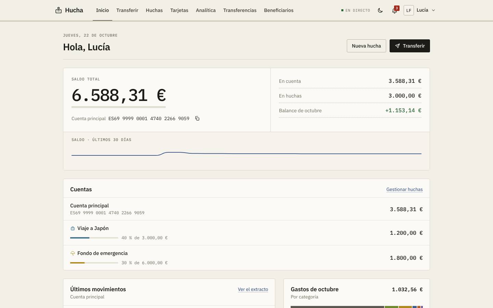

</div>

> Hucha no es un banco ni mueve dinero real. Es un proyecto para practicar lo que hace difícil una app financiera:
> que el dinero cuadre siempre, que una petición repetida no cobre dos veces y que la sesión sea segura.

## Índice

- [Qué se puede hacer](#qué-se-puede-hacer)
- [Capturas](#capturas)
- [Arquitectura](#arquitectura)
- [Decisiones técnicas](#decisiones-técnicas)
- [Diseño](#diseño)
- [Cómo arrancarlo](#cómo-arrancarlo)
- [Tests](#tests)
- [API](#api)
- [Estructura del repositorio](#estructura-del-repositorio)

## Qué se puede hacer

**Como cliente**

- **Abrir cuenta en un minuto**: al registrarte se crea una cuenta con IBAN español válido (módulo 97), una tarjeta virtual y un regalo de bienvenida.
- **Transferir** a cualquier IBAN en un asistente de 4 pasos. Entre clientes de Hucha llega al instante y el destinatario recibe un aviso en vivo.
- **Verificación por código (SCA, como pide PSD2)** para importes de 1.000 € o más, o de más de 30 € a alguien que no tienes guardado. El código caduca a los 5 minutos y se bloquea a los 3 fallos.
- **Huchas**: apartados con objetivo e icono, para meter y sacar dinero al instante. Al cerrarlas, el dinero vuelve a la cuenta.
- **Tarjeta virtual**: congelar, activar o desactivar las compras online, cambiar el límite mensual y un simulador de compras para ver cómo se autoriza o se deniega cada pago.
- **Movimientos** con búsqueda, filtros (entradas o salidas, categoría, fechas) y paginación. **Extracto mensual en PDF o CSV.**
- **Analítica**: ingresos y gastos por mes, gasto por categoría, evolución del saldo a 90 días y un resumen en lenguaje natural.
- **Avisos en tiempo real** (Server-Sent Events): dinero recibido, pagos denegados, códigos de verificación...
- **Seguridad**: cambio de contraseña, lista de sesiones abiertas por dispositivo y cierre remoto.
- Diseño propio inspirado en un libro de cuentas, con modo oscuro y versión móvil.

**Como administrador (back-office)**

- KPIs del banco, volumen de transferencias de los últimos 7 días y estado del outbox.
- Buscar clientes, ver sus cuentas, **congelarlas** o **bloquear el acceso** (cierra todas sus sesiones al momento).
- **Registro de auditoría** filtrable: logins, fallos, transferencias, cambios de tarjeta, extractos descargados...

## Capturas

| Transferencia con código de verificación | Justificante |
| --- | --- |
| 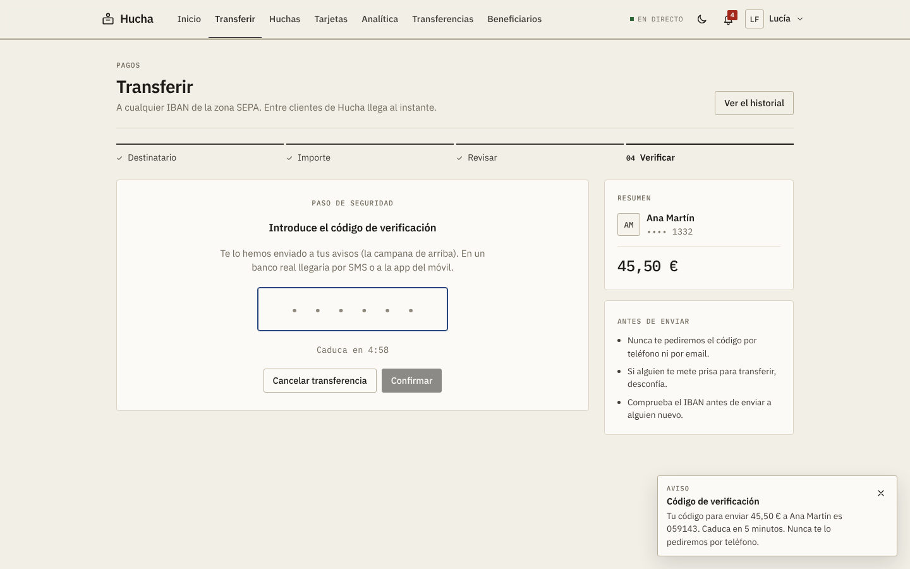 | 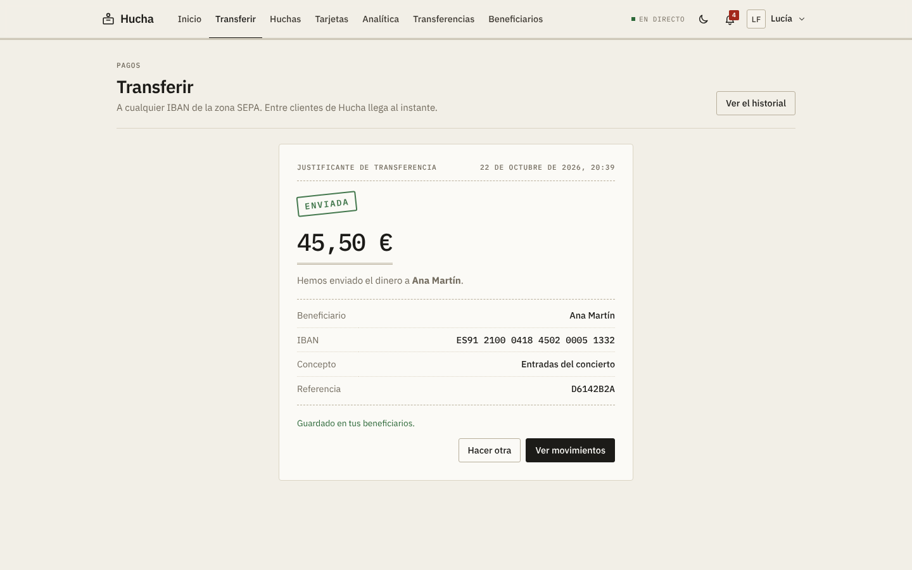 |

| Tarjeta virtual | Huchas |
| --- | --- |
| 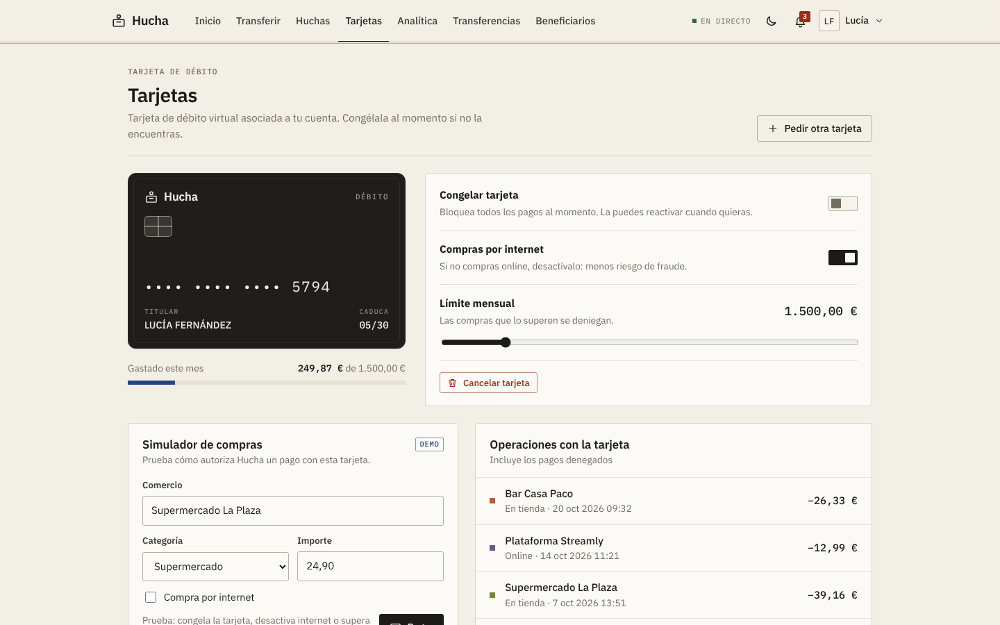 | 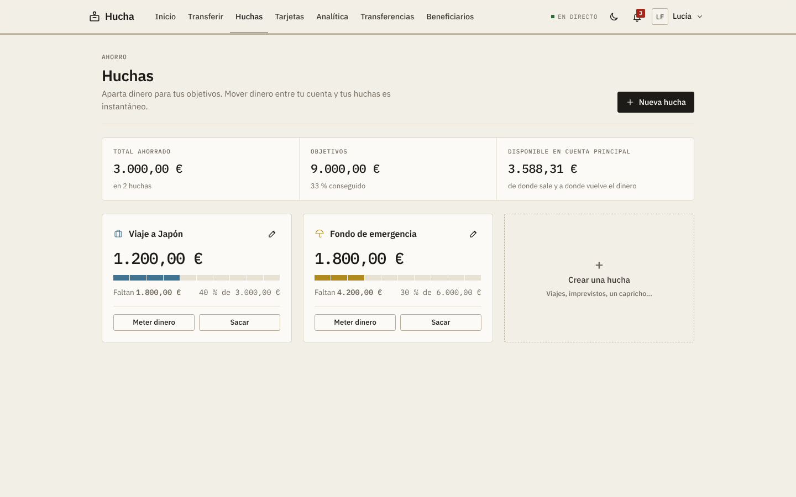 |

| Movimientos y extractos | Back-office: auditoría |
| --- | --- |
| 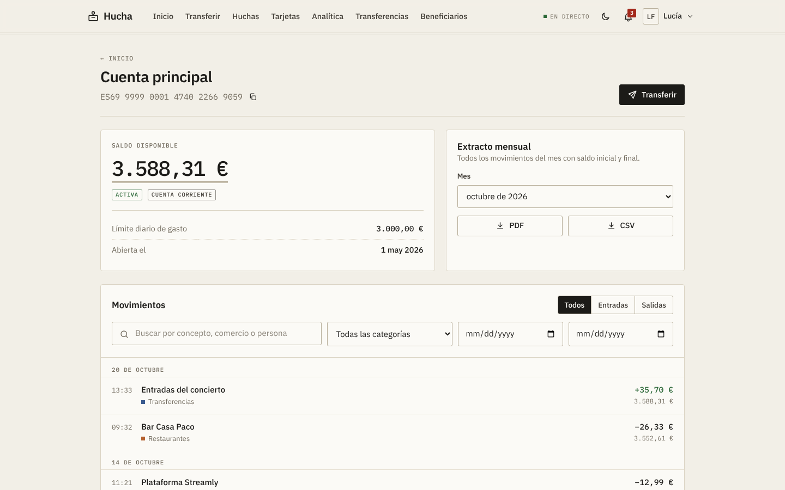 | 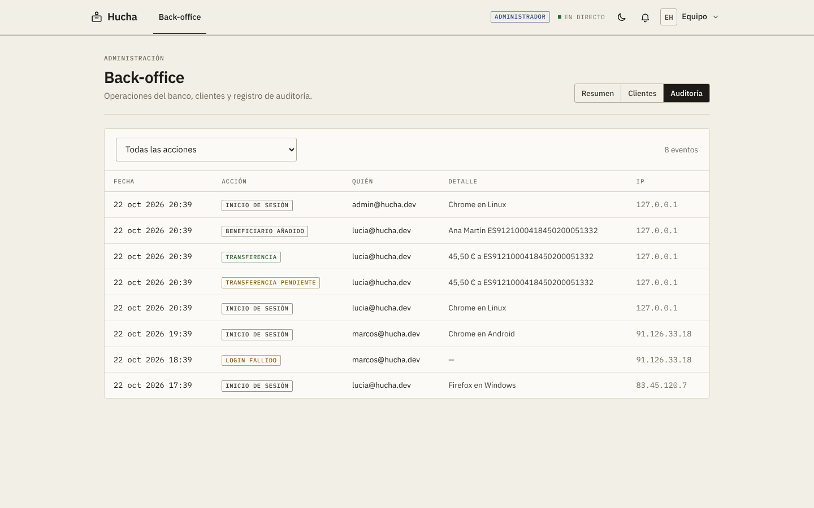 |

| Modo oscuro | Acceso |
| --- | --- |
| 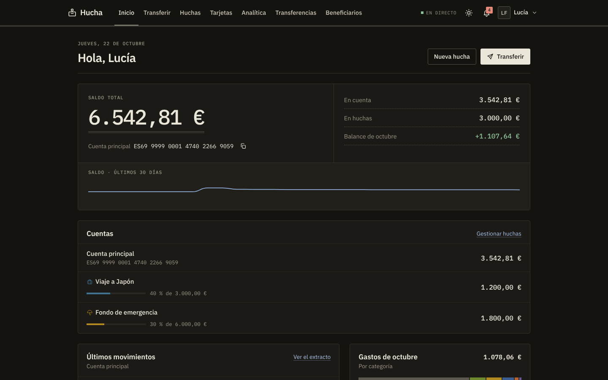 | 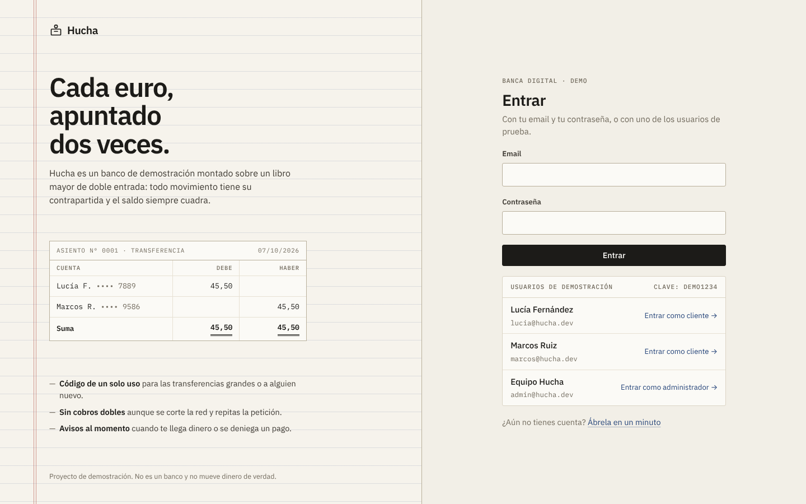 |

<details>
<summary><b>Analítica</b> (página completa)</summary>


</details>

**Móvil**

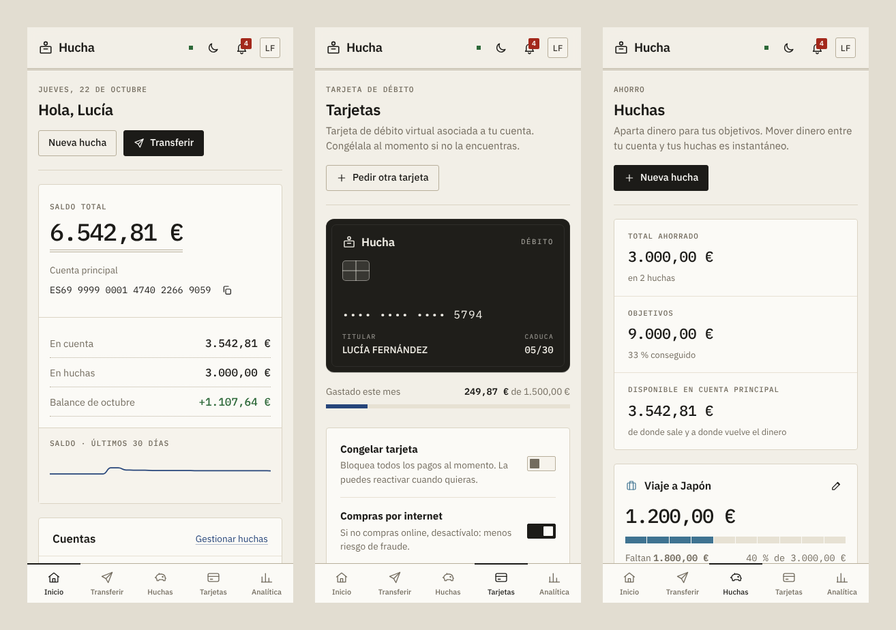

## Arquitectura

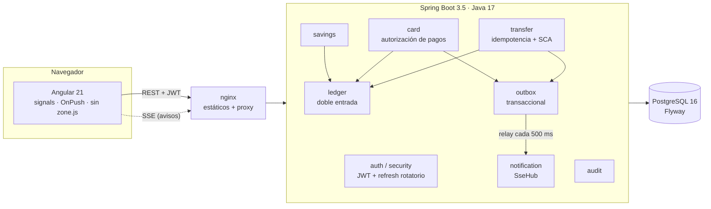

El backend es un **monolito modular**: un paquete por dominio (`account`, `ledger`, `transfer`, `card`, `savings`, `payee`, `statement`, `analytics`, `notification`, `outbox`, `audit`, `admin`, `auth`, `security`). Las reglas entre módulos no dependen de la buena voluntad: las comprueban tests de **ArchUnit** (sin ciclos entre paquetes, solo el libro mayor puede cambiar saldos, los controladores no tocan repositorios...).

### Una transferencia por dentro

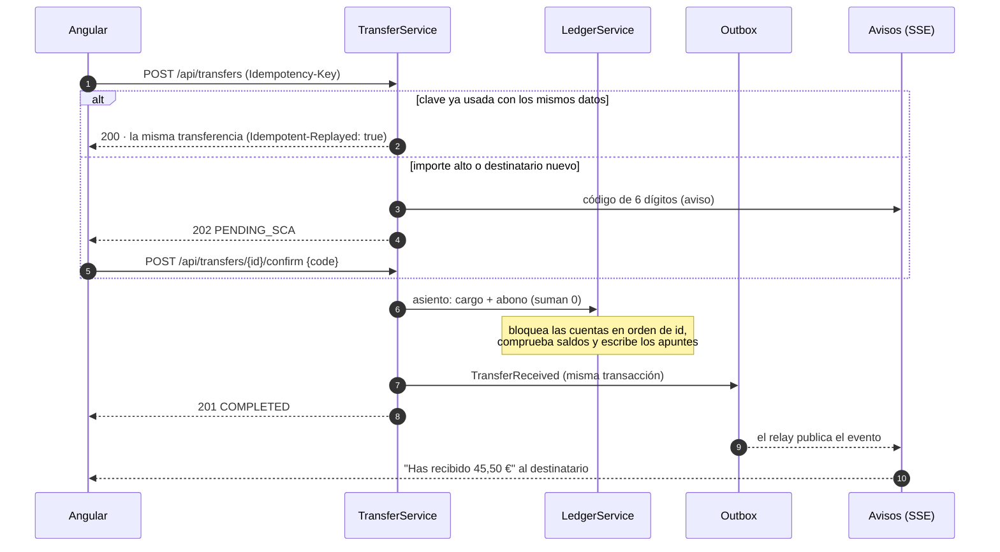

## Decisiones técnicas

| Problema | Cómo lo resuelve Hucha |
| --- | --- |
| **Que el dinero cuadre siempre** | Libro mayor de **doble entrada**: cada movimiento es un asiento con apuntes que suman exactamente cero. Las cuentas internas del banco (compensación SEPA, liquidación de tarjetas, fondos propios) hacen de contrapartida. Importes en `BigDecimal` / `NUMERIC(19,2)`, nunca `double`. Un `CHECK` en la base de datos impide saldos negativos en cuentas de clientes. |
| **Dos transferencias a la vez desde la misma cuenta** | `SELECT ... FOR UPDATE` (bloqueo pesimista) de las cuentas implicadas, **siempre en el mismo orden** (por id) para que dos transferencias cruzadas no se bloqueen entre sí. Un test lanza 10 transferencias a la vez contra una cuenta con 500 € y comprueba que nunca queda en negativo y que los apuntes cuadran con el saldo. |
| **Doble clic o respuesta perdida** | Cabecera **`Idempotency-Key`** obligatoria. Misma clave y mismos datos devuelven la misma transferencia sin volver a cobrar; misma clave con otros datos da `422`. Una restricción `UNIQUE` cubre la carrera entre dos peticiones simultáneas. El front reutiliza la clave al reintentar tras un error de red. |
| **Autenticación fuerte (PSD2)** | Código de un solo uso, guardado como hash, con caducidad y número máximo de intentos. El umbral depende del importe y de si el destinatario es de confianza. |
| **Sesión segura en una SPA** | *Access token* JWT (HS256) de 15 minutos **solo en memoria**, nunca en `localStorage`. *Refresh token* opaco en cookie `HttpOnly` + `SameSite=Strict` limitada a `/api/auth`, que **rota en cada uso**: si alguien reutiliza uno ya gastado, se revoca toda la familia de sesiones. Bloqueo temporal tras 5 intentos fallidos. Contraseñas con BCrypt. |
| **Avisos sin perder eventos** | **Outbox transaccional**: el evento se guarda en la misma transacción que el cambio y un proceso aparte lo publica. Si la transacción falla, no hay aviso falso; si el envío falla, se reintenta. Los avisos llegan al navegador por **Server-Sent Events**. |
| **Saber qué ha pasado** | Auditoría de cada acción sensible con actor, IP y navegador. Métricas de Micrometer en `/actuator/prometheus`. Errores en formato **ProblemDetail (RFC 9457)** con un `code` estable que el front usa para mostrar mensajes concretos. |
| **Tests que no dependen del reloj** | Toda la lógica usa un `Clock` inyectado; los tests lo mueven a voluntad (caducidad de códigos, bloqueos, JWT...). |
| **CSV seguro** | Los extractos CSV escapan las celdas que empiezan por `=`, `+`, `-` o `@` para evitar inyección de fórmulas en Excel. |
| **IP real detrás del proxy** | No se lee `X-Forwarded-For` a mano (se puede falsificar): Tomcat solo lo acepta si viene de la red interna. |

**Frontend**

- Angular 21 con componentes *standalone*, **signals**, `OnPush` en todo y **sin zone.js**.
- Formularios reactivos, *lazy loading* por página y guards por rol (cliente o administrador).
- Interceptor funcional que añade el token y, ante un `401`, **renueva una sola vez** y repite la petición. Si hay varias a la vez, comparten la misma renovación.
- **Gráficos SVG hechos a mano** (barras, barra de reparto y línea con *tooltip*), sin librerías. Miden su ancho real con `ResizeObserver` para que el texto no se deforme.
- Sistema de diseño propio en CSS con variables, modo claro y oscuro, y las fuentes incluidas en el bundle (sin peticiones a Google Fonts).
- Accesibilidad: `<dialog>` nativo para los modales, roles ARIA, foco visible y `prefers-reduced-motion`.

## Diseño

La interfaz no parte de ninguna plantilla ni librería de componentes. La idea sale del propio backend: si el dinero se apunta en un **libro mayor**, la aplicación se parece a uno.

- **Papel y tinta.** Fondo color papel, texto casi negro y **un solo color de acento** (tinta azul). Nada de degradados.
- **Cifras en monoespaciada** (IBM Plex Mono). Los importes, IBAN, fechas y referencias se alinean en columna como en un extracto; el resto del texto va en IBM Plex Sans.
- **Convenciones contables.** Los totales llevan doble subrayado, los ingresos van en verde, el signo menos es el tipográfico (−) y los números rojos son rojos.
- **Líneas finas en lugar de sombras**, esquinas casi rectas y etiquetas tipo sello para los estados (`ENVIADA`, `CONGELADA`).
- **Piezas con intención:** el justificante parece un ticket impreso, el progreso de las huchas es una regla graduada y la portada muestra un asiento de doble entrada sobre papel pautado con margen rojo.
- **Gráficos sobrios:** barras planas, una barra de reparto en lugar de un donut (las longitudes se comparan mejor que los ángulos) y una línea sin relleno.

## Cómo arrancarlo

### Con Docker (todo incluido)

```bash
cp .env.example .env        # y rellena POSTGRES_PASSWORD y JWT_SECRET (openssl rand -base64 48)
docker compose up --build
```

Abre **http://localhost:4200**. Swagger UI queda en http://localhost:8080/swagger-ui.html.

### En local, para desarrollar

Requisitos: **Java 17** y **Node 24**. No hace falta base de datos: por defecto usa H2 en memoria en modo PostgreSQL.

```bash
# API en http://localhost:8080
cd backend
./mvnw spring-boot:run

# Web en http://localhost:4200 (redirige /api al backend)
cd frontend
npm ci
npm start
```

Para usar PostgreSQL en local: `SPRING_PROFILES_ACTIVE=postgres DB_PASSWORD=... ./mvnw spring-boot:run`.

### Usuarios de prueba

| Email | Contraseña | Rol |
| --- | --- | --- |
| `lucia@hucha.dev` | `Demo1234` | Cliente con 6 meses de movimientos, huchas y tarjeta |
| `marcos@hucha.dev` | `Demo1234` | Cliente (para probar transferencias entre los dos) |
| `admin@hucha.dev` | `Demo1234` | Administrador (back-office) |

En la pantalla de login hay botones para entrar con cada uno. Para probar el código de verificación, haz una transferencia de más de 30 € a un IBAN nuevo: el código aparece en los avisos (la campana).

## Tests

```bash
cd backend && ./mvnw verify       # 124 tests + informe de cobertura JaCoCo en target/site/jacoco
cd frontend && npm run test:ci    # 35 tests con Vitest
```

- **Backend**: tests unitarios (IBAN, Luhn, importes, CSV, bloqueo de usuarios), tests de integración de cada flujo con MockMvc (registro, login, rotación y robo de *refresh token*, transferencias con SCA e idempotencia, tarjetas, huchas, extractos, back-office, SSE), un test de **concurrencia** y reglas de **arquitectura** con ArchUnit. Un test con **Testcontainers** levanta un PostgreSQL real para comprobar las migraciones de Flyway (se salta solo si no hay Docker).
- **Frontend**: utilidades (IBAN, formato de importes, escalas de los gráficos), el interceptor de autenticación con `HttpTestingController` y el asistente de transferencias completo: corte de red, reintento con la misma `Idempotency-Key`, paso de verificación y justificante.

La integración continua (GitHub Actions) ejecuta los tests de los dos proyectos, comprueba el formato con Prettier y compila la versión de producción.

## API

Documentación interactiva en **`/swagger-ui.html`** (OpenAPI 3). Resumen:

| Recurso | Endpoints |
| --- | --- |
| Autenticación | `POST /api/auth/register` · `login` · `refresh` · `logout` |
| Perfil | `GET /api/me` · `PUT /api/me/password` · `GET/DELETE /api/me/sessions` |
| Cuentas | `GET /api/accounts` · `GET /api/accounts/{id}` · `GET /api/accounts/{id}/movements` · `GET /api/accounts/{id}/statement?month=2026-09&format=pdf` |
| Transferencias | `POST /api/transfers` · `POST /api/transfers/{id}/confirm` · `POST /api/transfers/{id}/cancel` · `GET /api/transfers` |
| Beneficiarios | `GET/POST /api/payees` · `PUT/DELETE /api/payees/{id}` · `GET /api/payees/check-iban` |
| Tarjetas | `GET/POST /api/cards` · `PATCH /api/cards/{id}` · `POST /api/cards/{id}/cancel` · `POST /api/cards/{id}/simulate-purchase` · `GET /api/cards/{id}/transactions` |
| Huchas | `GET/POST /api/savings` · `PUT/DELETE /api/savings/{id}` · `POST /api/savings/{id}/deposit` · `withdraw` |
| Analítica | `GET /api/analytics/summary?months=6` |
| Avisos | `GET /api/notifications` · `GET /api/notifications/stream` (SSE) · `POST /api/notifications/{id}/read` · `read-all` |
| Back-office | `GET /api/admin/overview` · `users` · `audit` · `POST /api/admin/users/{id}/block` · `POST /api/admin/accounts/{id}/freeze` |

Ejemplo de error:

```json
{
  "type": "https://hucha.dev/errors/daily-limit-exceeded",
  "title": "Unprocessable Entity",
  "status": 422,
  "detail": "Supera tu límite diario. Hoy aún puedes enviar 1.250,00 €.",
  "instance": "/api/transfers",
  "code": "DAILY_LIMIT_EXCEEDED"
}
```

## Estructura del repositorio

```
hucha/
├── backend/                     Spring Boot
│   ├── src/main/java/.../hucha/
│   │   ├── account/             cuentas e IBAN
│   │   ├── ledger/              libro mayor de doble entrada
│   │   ├── transfer/            transferencias, idempotencia y SCA
│   │   ├── card/                tarjetas y autorización de pagos
│   │   ├── savings/ payee/ statement/ analytics/
│   │   ├── notification/ outbox/ audit/ admin/
│   │   ├── auth/ security/ user/
│   │   └── shared/              errores, dinero, reloj...
│   ├── src/main/resources/db/migration/   migraciones Flyway
│   └── Dockerfile
├── frontend/                    Angular
│   ├── src/app/core/            API, sesión, interceptor, formatos
│   ├── src/app/shared/          iconos, modales, gráficos SVG
│   ├── src/app/features/        una carpeta por pantalla
│   ├── nginx.conf
│   └── Dockerfile
├── docs/screenshots/
└── docker-compose.yml
```

## Qué está simulado

- Las transferencias a otros bancos no salen de verdad: se apuntan contra una cuenta interna de "compensación SEPA".
- El código de verificación llega como aviso dentro de la app en vez de por SMS.
- Las compras con tarjeta se generan con el simulador.

---

Hecho por **Ramón** · [LinkedIn](https://www.linkedin.com/in/ram%C3%B3n-%C3%A1ngel-0190312a0/) · [GitHub](https://github.com/ramonnnarokomo)
